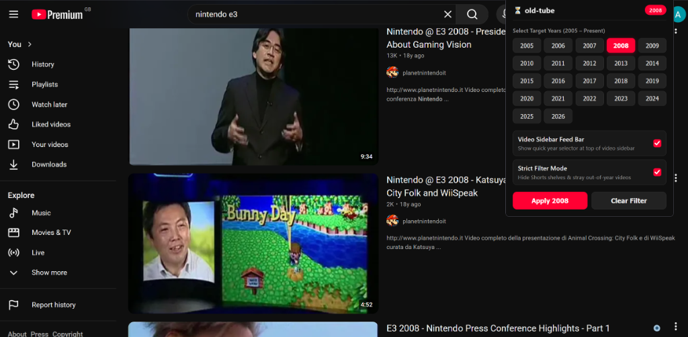
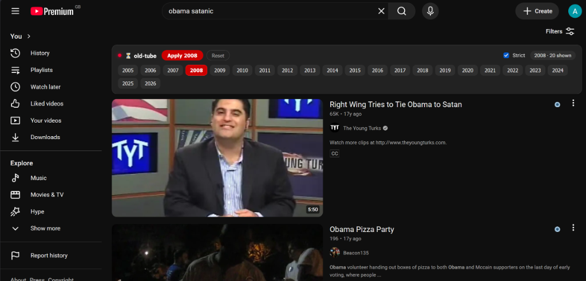
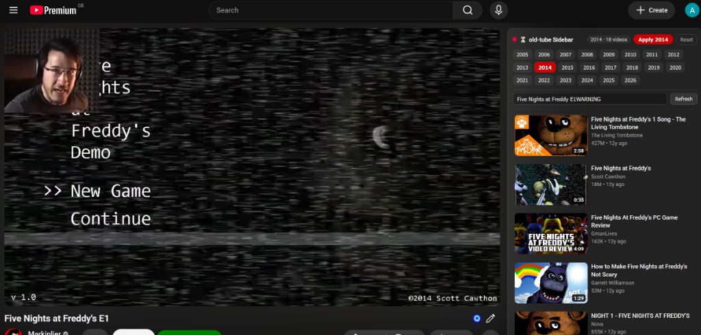

#  old-tube

Sick of the obnoxious, and shit content the YouTube algorithm is force feeding down you? Or the waves of clickbait, and annoying thumbnails? Well hopefully this extension will help you out a bit. With this you can select to have all search results from YouTube be from a certain particular year, such as 2014, or 2007. And you can also have multiple selected at a time if you prefer to instead like both 2014 and 2007.  It also replaces suggested videos in the sidebar to the year you wish to watch them from as well. Project is currently experimental, and we shall see how it goes.

## Screenshots

